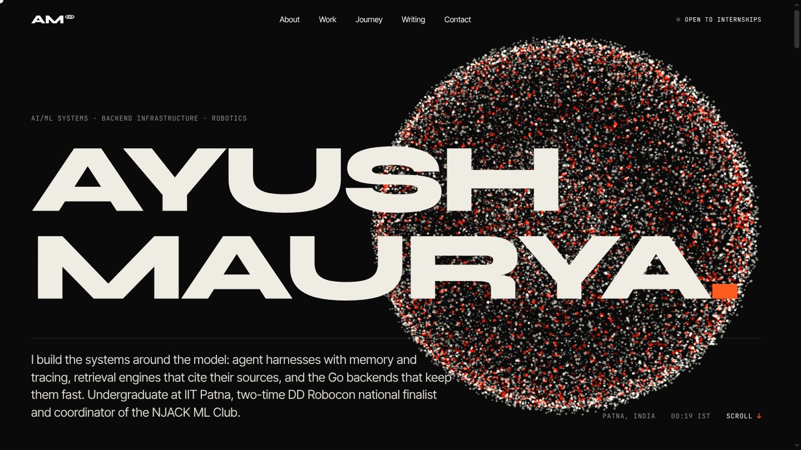

# Ayush Maurya — Portfolio

**Live site: [ayush-maurya.ayush-maurya-portfolio.workers.dev](https://ayush-maurya.ayush-maurya-portfolio.workers.dev)**

[](https://ayush-maurya.ayush-maurya-portfolio.workers.dev)

My personal site: the systems I have built, the competitions I have been part of, and the writing I manage at [The Learning Curve](https://thelearningcurvenjack.substack.com). It is a single page with a WebGL particle backdrop that changes shape as you scroll from one section to the next.

## What is on it

| Section | Contents |
| :-- | :-- |
| **About** | Who I am: B.Tech at IIT Patna (class of 2028), AI/ML systems and backend infrastructure |
| **Work** | Eleven projects, each expandable: sipSup, Flux, devRAG, Aegis, Sentinel, Feather, ICU Sentinel and more |
| **Journey** | DD Robocon (national finalist ×2), Inter IIT Tech Meet 14.0, Silicon Labs IoT Challenge, NJACK ML Club |
| **Writing** | The Learning Curve, the Substack magazine of NJACK, IIT Patna |
| **Stack** | The tools I use, grouped by theory, languages and operations |
| **Contact** | Email (click to copy), GitHub, LinkedIn, Substack |

## How it is built

- **[Vite](https://vite.dev) + TypeScript**, no UI framework. The page is plain HTML rendered from one data file.
- **[three.js](https://threejs.org)** for the particle scene. Up to 20,000 points morph between shapes (sphere, helix and others), one per section.
- **[GSAP](https://gsap.com) + ScrollTrigger** for scroll-driven reveals, counters and the section-to-shape mapping.
- **[Lenis](https://lenis.darkroom.engineering)** for smooth scrolling.
- **Self-hosted fonts** through Fontsource: Syne, Inter Tight and JetBrains Mono. Nothing is loaded from a font CDN.
- **Cloudflare Workers static assets** for hosting.

The site respects `prefers-reduced-motion` (animations and smooth scroll are switched off) and falls back to a static page when WebGL is unavailable.

## Project layout

```
index.html        Page structure and static copy
src/
  data.ts         All content: projects, journey, magazine posts, stack
  main.ts         Rendering, scroll animation, cursor, loader
  scene.ts        The three.js particle scene and its shapes
  style.css       All styling
public/
  _headers        Cache and security headers
  favicon.svg
```

To change what the site says, edit `src/data.ts`. Projects, journey cards, posts and the stack are all rendered from it.

## Run it locally

Requires Node.js 20 or newer.

```bash
npm install
npm run dev
```

Then open the URL Vite prints (by default `http://localhost:5173`).

## Build and deploy

```bash
npm run build
```

This type-checks the code and writes the static site to `dist/`. Any static host can serve that folder.

To publish to Cloudflare (needs a free account and `npx wrangler login` once):

```bash
npm run deploy
```

## Contact

- Email: mauryaayush8114@gmail.com
- GitHub: [@6sLOGAN78](https://github.com/6sLOGAN78)
- LinkedIn: [ayush-maurya](https://www.linkedin.com/in/ayush-maurya-5a8308339)
- Substack: [The Learning Curve](https://thelearningcurvenjack.substack.com)
